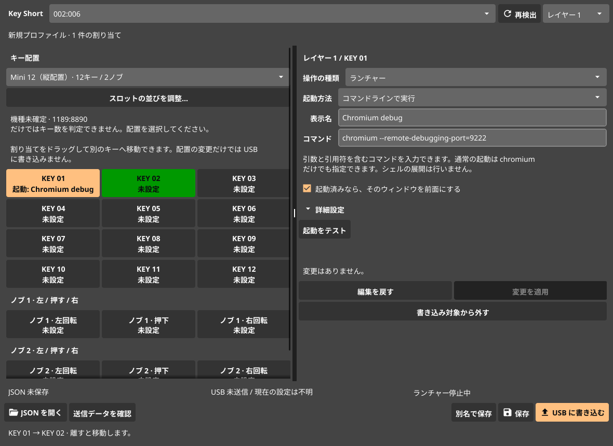
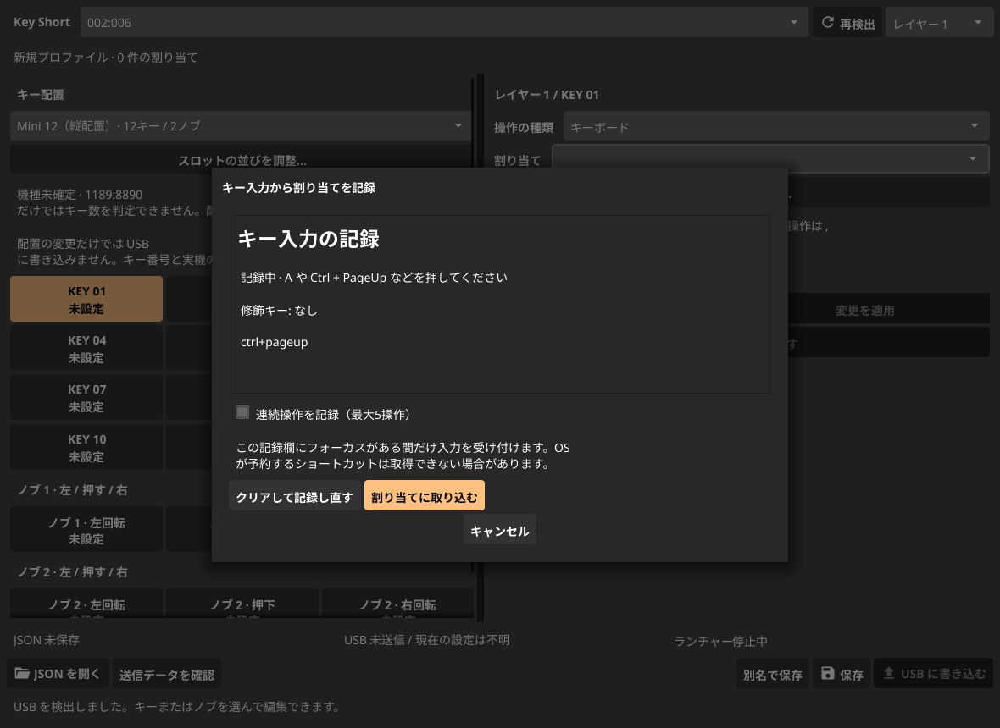

# Key Short

USB ID `1189:8890` の MINI KeyBoard を設定するデスクトップアプリです。Go と Fyne を使用し、Linux、Windows、macOS のネイティブ処理を実装しています。3・6・9・12キーの配置プリセットと、最大12キー・2ノブのカスタム配置に対応しています。


## 機能

- キーと、各ノブの左回転・押下・右回転への割り当て。
- 割り当てのドラッグ移動と、設定済みのキー同士の入れ替え。
- 配置プリセットの選択、手動のスロット並べ替え、保存済み配置の復元。
- 右側の編集パネル、適用前の入力検証、JSON・USB・ランチャーの独立した状態表示。
- Ctrl、Shift、Alt、Super などを組み合わせたショートカット。
- 最大5操作の連続入力、F1〜F24、日本語キーボードの一部のキー。
- 音量、ミュート、再生などのメディア操作。
- マウスクリック、ホイール、Ctrl とホイールの組み合わせ。
- 3レイヤーの設定、LED モード0〜2の指定。
- JSON の保存・読み込み、送信するバイト列の確認。
- CLI によるデバイス検出、送信データの確認、設定の書き込み。
- インストール済みアプリの選択、引数付きコマンドの実行。
- 起動済みウィンドウの再利用と前面化。KDE Plasma の Wayland と X11 に対応。
- USB ボタンの常駐監視、トレイ常駐、前回保存した JSON の復元。
- A や Ctrl+PageUp などを実際に押して割り当てを記録。最大5操作の連続記録に対応。

## ビルド

Go 1.26 以降と C コンパイラーを使用します。Windows/macOS の手順は [対応環境とビルド](docs/platforms.md) を参照してください。以下は Linux の手順です。Linux では pkg-config、libusb、OpenGL、X11 の開発ライブラリーを使用します。Wayland 環境では XWayland を使用します。

Artix Linux / Arch Linux:

```sh
sudo pacman -S --needed go base-devel pkgconf libusb libglvnd libxcursor libxrandr libxinerama libxi libxxf86vm ttf-droid
make build
```

Debian / Ubuntu:

```sh
sudo apt install build-essential pkg-config libusb-1.0-0-dev libgl1-mesa-dev xorg-dev fonts-droid-fallback
make build
```

Debian / Ubuntu では Go 1.26 以降を別途用意してください。日本語の表示には Droid Sans Fallback または Noto Sans JP の TTF を使用します。別のフォントを使う場合は `FYNE_FONT=/path/to/font.ttf ./bin/key-short` として起動してください。

## USB のアクセス権限

Linux では最初に udev ルールをインストールし、USB デバイスを抜き差しします。Windows/macOS では udev を使用しません。

```sh
sudo ./scripts/install-udev.sh
```

ルールは `/etc/udev/rules.d/70-key-short.rules` に配置されます。`1189:8890` の USB デバイスと入力イベントに限って `uaccess` を付与します。Artix の elogind または systemd-logind による、ローカルセッションへのアクセス権限の付与を想定しています。ランチャー機能の追加前にルールを導入していた場合も、このスクリプトを再実行してください。

リモートセッションや elogind/logind を使用しない環境では、管理者が USB デバイスへのアクセス権限を設定してください。アプリは一般ユーザーで起動します。

## 起動と操作

```sh
./bin/key-short
```

1. 対象の USB デバイスを選択します。接続後は「再検出」で一覧を更新します。
2. キー配置のプリセットを選び、レイヤーとキー、またはノブの操作を選択します。
3. 右側で操作の種類と割り当てを指定し、「変更を適用」を押します。
4. 「保存」で設定を JSON ファイルに保存します。初回は保存先フォルダーとファイル名を指定します。「別名で保存」も使用できます。
5. 「送信データを確認」で内容を確認し、「USB に書き込む」を押します。
6. 実際のキー・ノブ操作で結果を確認します。

初期状態の設定は空です。追加した項目だけを送信します。「書き込み対象から外す」はアプリ内の設定から項目を取り除きます。本体の割り当ては消去しません。空のキー操作を送る場合は `keyboard` の値に `none` を指定できますが、無効化の挙動は本体のファームウェアに依存します。

キーの編集中は、JSON 保存・USB 送信・監視開始を保留します。「変更を適用」でプロファイル全体の整合性を検証して確定するか、「編集を戻す」で破棄してください。別のキーや配置へ切り替える場合も、未適用の変更を破棄するか確認します。

画面下部には「JSON 未保存」「USB 未送信 / 未反映 / 送信済み」「ランチャー停止中 / 監視中」を別々に表示します。JSON の保存では USB の状態を変更しません。USB の「送信済み · 実機未検証」は転送の完了を意味します。読み戻して照合した結果ではありません。

JSON の保存は、保存先を開く前に設定を検証し、一時ファイルへの書き込みを終えてから置き換えます。「別名で保存」で既存ファイルを指定した場合は、置き換えを確認します。キャンセル、検証失敗、保存確認中の設定変更では既存ファイルを変更しません。

アプリを閉じる前に JSON に保存してください。次回の GUI 起動時に、最後に保存・読み込みした JSON を開きます。未保存の編集内容は復元しません。

アプリメニューに登録する場合:

```sh
make install
```

実行ファイルは `~/.local/bin/key-short`、デスクトップエントリーは `${XDG_DATA_HOME:-~/.local/share}/applications/key-short.desktop` に配置されます。

## ドラッグで起動するキーを変更する

表示中のレイヤーで、割り当てのあるキーやノブを移動先へドラッグします。アプリの起動設定は、引数やウィンドウの再利用オプションも含めて移動します。キーボード、メディア、マウスの割り当ても同じ操作で移動できます。

1. キーを編集中の場合は「変更を適用」または「編集を戻す」を押します。
2. 割り当てのあるキーやノブを、別のキーやノブへドラッグして離します。
3. 移動先に割り当てがある場合は、確認画面で「入れ替える」を押します。両方の割り当てを保持して入れ替えます。
4. JSON に保存し、USB に書き込みます。ランチャーを使う場合は監視を開始し直します。

同じキーや配置の外で離すとキャンセルします。空きキーへ移動した場合は、移動元に `keyboard` の `none` を残し、次の USB 書き込みで無効化するデータを送信します。移動はプロファイル全体で検証するため、移動後のランチャー予約キーと衝突する場合は適用しません。



## キー入力から割り当てを記録する

1. キーの編集画面で操作を「キーボード」にし、「キー入力から記録…」を押します。
2. 記録欄にフォーカスがある状態で、割り当てたいキーを押します。A は `a`、Ctrl を押しながら PageUp を押すと `ctrl+pageup` と表示します。
3. 「割り当てに取り込む」を押すと、編集画面の割り当て欄へ反映します。
4. 「変更を適用」から JSON の保存と USB への書き込みへ進みます。

「連続操作を記録」を有効にすると最大5操作を順に記録します。長押しのリピートは追加しません。修飾キーの左右を区別し、修飾キーだけでは操作を確定しません。記録欄からフォーカスが外れると一時停止します。OS が予約するショートカットは取得できない場合があります。入力はログへ出力しません。



## アプリランチャー

1. キーを選び、操作を「ランチャー」にします。
2. 「アプリを選択」でインストール済みアプリを選ぶか、「コマンドラインで実行」で引数付きコマンドを入力します。
3. 再利用したい場合は「起動済みなら、そのウィンドウを前面にする」を有効にします。無効の場合は押すたびに起動コマンドを実行します。
4. 「起動をテスト」で起動と前面化を確認します。この操作は USB への書き込みを必要としません。
5. 「変更を適用」、JSON の保存、USB への書き込みを行い、「LED・ランチャー設定」を開いて「ランチャー監視を開始」を押します。

「閉じてもトレイに常駐」を有効にすると、設定ウィンドウを閉じた後も監視を続けます。設定を変更すると監視を停止します。設定変更後は監視を開始し直してください。保存済みの設定で監視を有効にして終了した場合は、次の GUI 起動時に監視を再開します。

コマンド例、起動履歴の扱い、対応環境は [アプリランチャーの使い方](docs/launcher.md) を参照してください。サンプルは [examples/app-launcher.json](examples/app-launcher.json) にあります。

## 割り当ての記法

| 種類 | 例 | 動作 |
| --- | --- | --- |
| `keyboard` | `ctrl+c` | Ctrl+C |
| `keyboard` | `ctrl+shift+s` | Ctrl+Shift+S |
| `keyboard` | `ctrl+c,ctrl+v` | 2つのショートカットを順に送信 |
| `keyboard` | `f13` | F13 |
| `keyboard` | `henkan` | 変換キー |
| `media` | `volume_up` | 音量を上げる |
| `media` | `play_pause` | 再生・一時停止 |
| `mouse` | `left_click` | 左クリック |
| `mouse` | `ctrl+wheel_down` | Ctrl を伴う下スクロール |

修飾キーは `ctrl`、`shift`、`alt`、`super`、`rctrl`、`rshift`、`ralt`、`rsuper` です。マウス操作では `ctrl`、`shift`、`alt` を使用できます。

記号は `comma`、`dot`、`slash`、`semicolon`、`equal` などの HID キー名で指定します。文字列の入力や日本語テキストのマクロではありません。出力される文字は OS のキーボード配列に依存します。キーボードマクロに任意の待ち時間は指定できません。アプリの起動には「ランチャー」を使用します。

## CLI

デバイスを検出します。この操作は本体に設定を書き込みません。

```sh
./bin/key-short -list
```

サンプル設定の送信データを表示します。USB デバイスがなくても使用できます。

```sh
./bin/key-short -dry-run examples/volume-and-shortcuts.json
```

設定を本体に書き込みます。`-device` の値は `-list` の結果で置き換えてください。対象が1台の場合は `-device` を省略できます。

```sh
./bin/key-short -device 002:003 -apply examples/volume-and-shortcuts.json
```

CLI の `-apply` は確認画面を表示せずに書き込みます。サンプルはキー1・2と両方のノブを上書きします。

GUI を開かずにランチャーを常駐させる場合:

```sh
./bin/key-short -listen examples/app-launcher.json
```

USB を使わず、指定スロットの起動・前面化を実行する場合:

```sh
./bin/key-short -launch examples/app-launcher.json -layer 1 -slot 2
```

指定の設定で GUI を開く場合:

```sh
./bin/key-short -profile examples/app-launcher.json
```

`-verbose` で送信データを含む DEBUG ログを有効にできます。DEBUG と INFO は標準出力、WARN と ERROR は標準エラー出力に送ります。処理を継続できない場合は ERROR を出力し、終了コード1を返します。

## 設定ファイル

```json
{
  "version": 1,
  "device": "1189:8890",
  "led": null,
  "bindings": [
    { "layer": 1, "slot": 1, "kind": "keyboard", "value": "ctrl+c" },
    { "layer": 1, "slot": 18, "kind": "media", "value": "volume_up" }
  ]
}
```

`led: null` は LED を変更しません。0 は消灯、1 と2はファームウェアのプリセットです。

| 入力番号 | 操作 |
| --- | --- |
| 1〜12 | キー1〜12 |
| 13 / 14 / 15 | ノブ1の左回転 / 押下 / 右回転 |
| 16 / 17 / 18 | ノブ2の左回転 / 押下 / 右回転 |

画面のキー配置はプリセットとカスタム配置から選択します。USB ID だけではキー数や配置を確定しません。実機との対応が異なる場合は「スロットの並びを調整…」で表示順を変更してください。詳しくは [キー配置の設定](docs/layouts.md) を参照してください。

## 通信と検証状況

提供された `Release/MINI KeyBoard.exe` の通信処理を解析し、Report ID 3、65バイトのレポート、レイヤー指定、キーボード・メディア・マウス・LED の保存処理を確認しました。設定用インターフェース1の interrupt OUT エンドポイント `0x02` に送信します。キーボード・マウス用インターフェースのドライバー解除や USB リセットは行いません。

この環境では `1189:8890` の接続と USB ディスクリプターを確認しています。本体への設定書き込みと、12キー・2ノブの操作結果は未検証です。USB のアクセス権限を付与してから実機で確認してください。レイヤー2・3や LED の対応状況はファームウェアによって異なります。

Windows/macOS は HIDAPI で設定用 HID インターフェースに Report ID 3 を送信します。Windows は Raw Input / Win32、macOS は IOHIDManager / AppKit / Accessibility のランチャー処理を実装しています。各 OS の CI でビルドと自動テストを確認しますが、Windows/macOS の USB 実機動作は未検証です。

ランチャーは、KDE Plasma の Wayland セッションでテスト用アプリの起動と前面化を確認しました。X11 バックエンドも XWayland 上のテスト用ウィンドウで確認しています。物理ボタンからの起動は未検証です。

本体の現在の割り当てを読み出す機能はありません。送信成功は USB 転送の完了を表し、保存内容を読み戻して照合した結果ではありません。途中で通信が失敗すると一部だけ設定されることがあります。その場合は接続し直し、JSON から再送信してください。

関連する公開資料:

- [Fyne のビルド手順](https://docs.fyne.io/started/)
- [gousb の API](https://pkg.go.dev/github.com/google/gousb)
- [同じデバイスのプロトコル調査](https://github.com/jgt87/Macropad/blob/main/custom/PROTOCOL.md)
- [libusb による実装例](https://github.com/devkev/hid-minikb-libusb)

元の Windows バイナリーと ZIP は参照用として元の場所に残し、Git の管理対象から除外しています。逆コンパイルしたコードはアプリに含めていません。

## 開発時の検証

```sh
make test
make check
make build
```

テストでは提供された Windows 版の送信形式と期待するフレームを照合し、複数操作、ノブ2、レイヤー、LED の保存コマンド、不正な入力、JSON の保存・読み込みを検証します。配置の切り替えと復元、配置外スロットの送信拒否、編集中の衝突検出、保存キャンセル時の既存ファイル保護も検証します。テストは USB に設定を書き込みません。

GitHub Actions は3 OS の vet・テスト・ネイティブビルドを実行します。Linux では整形、モジュール整合性、競合検出、脆弱性検査も行います。Dependabot は Go Modules と GitHub Actions の更新を毎週金曜 09:00（Asia/Tokyo）に確認します。[CI の構成と調査結果](docs/ci.md) を参照してください。

ランチャーのテストでは、引数と引用符の保持、起動履歴の永続化、PID の再利用、連打、入力イベント、監視プロセスの排他、GUI からの設定を検証します。通常のテストは実際のアプリを起動しません。

実デスクトップでの統合テストは、テスト専用ウィンドウを開いて前面化します。

```sh
KEY_SHORT_TEST_DESKTOP=1 go test -p 1 ./internal/window ./internal/launcher -run 'TestDesktopBackends|TestNativeLaunchAndPersistentFocus' -v -count=1
```
