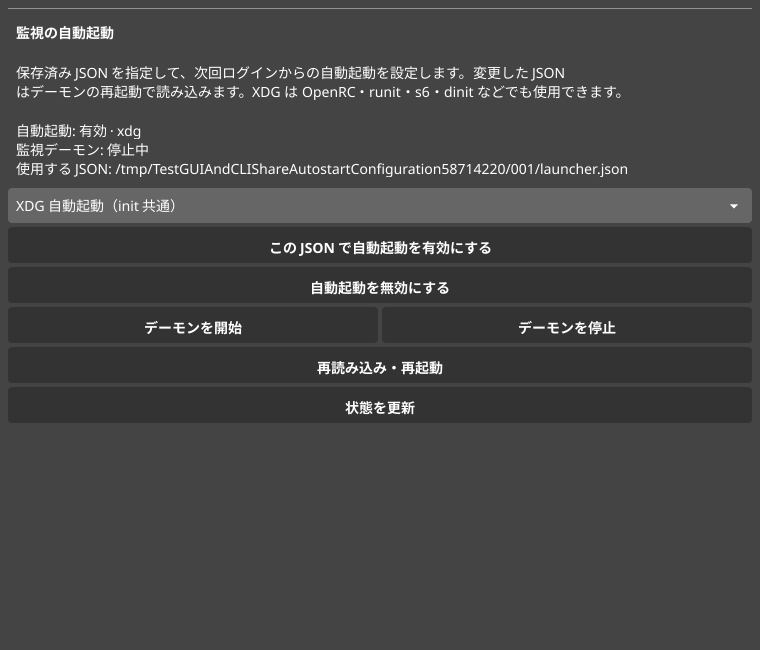

# 監視の自動起動

Linux のデスクトップへのログイン時に、キーからアプリを起動する監視デーモンを開始できます。GUI、CLI、make は同じ設定を使用します。設定には、ランチャーの割り当てを含む保存済み JSON を指定します。USB への割り当て書き込みは別に実行してください。

## 起動方式

| 選択 | 動作 |
| --- | --- |
| `auto` | systemd ユーザーマネージャーと有効な `graphical-session.target` を確認できる場合は `systemd`、それ以外は `xdg` を選択 |
| `systemd` | systemd ユーザーサービスを、グラフィカルセッションの開始時に起動 |
| `xdg` | XDG 規格に対応したデスクトップの自動起動を使用 |

OpenRC、runit、s6、dinit、SysV init などの環境でも、XDG 自動起動に対応するデスクトップから監視を開始できます。KDE Plasma や Xfce など、ログインセッションの自動起動機能を使用する構成です。`auto` の選択は設定時に行い、実際に選んだ方式を保存します。

ウィンドウマネージャー単体では、XDG 自動起動を実行する設定が必要です。ログイン時の起動コマンドとして直接 `key-short -daemon /absolute/path/to/profile.json` を指定する方法もあります。デスクトップアプリの起動と前面化を行うため、監視はログインユーザーで実行します。

systemd は異常終了時に5秒後に再起動します。XDG の共通方式では、デスクトップへのログイン時に起動します。異常終了後は CLI や GUI から開始し直すか、次のログインで起動します。

## make で導入する

アプリだけをインストールする場合:

```sh
make install
```

アプリのインストールと自動起動の登録をまとめて行う場合:

```sh
make install-autostart PROFILE="$HOME/key-short.json"
```

起動方式を指定する場合:

```sh
make install-xdg PROFILE="$HOME/key-short.json"
make install-systemd PROFILE="$HOME/key-short.json"
```

同じ設定に両方の方式を重ねて登録することはありません。方式を切り替えると、以前の設定を解除します。新しく登録した自動起動は、次のデスクトップログインから有効になります。今すぐ開始する場合は、次を実行します。

```sh
~/.local/bin/key-short -autostart start
```

すでに監視デーモンが動作している状態で起動方式や使用する JSON を変更した場合は、変更後の設定で監視を開始し直します。make と自動起動の設定は sudo を付けずに実行してください。USB のアクセス権限は [README の手順](../README.md#usb-のアクセス権限) で設定します。

## GUI から変更する

1. `make install` でアプリをインストールします。
2. GUI でランチャーの割り当てを設定し、JSON に保存します。
3. 「LED・ランチャー設定」を開き、「監視の自動起動」で起動方式を選択します。
4. 「この JSON で自動起動を有効にする」を押します。
5. 今すぐ監視する場合は「デーモンを開始」を押します。

「自動起動を無効にする」は、監視デーモンを停止して自動起動の登録を解除します。「デーモンを停止」は、次回ログイン時の自動起動を維持したまま停止します。「再読み込み・再起動」は、保存した JSON を読み込んで開始し直します。



GUI には有効・無効、選択した方式、使用する JSON、監視デーモンの実行状態を表示します。CLI で変更した内容も定期的な状態更新で反映します。「状態を更新」から手動で更新することもできます。

自動起動を有効にすると、以前の「GUI を開いたときに常駐監視を再開する」設定を解除し、二重起動を防ぎます。GUI の監視が動作中に「デーモンを開始」を押した場合は、GUI の監視を停止してからデーモンへ切り替えます。

GUI で割り当てを変更した場合や USB に書き込む場合は、監視デーモンを停止します。JSON の保存と USB への書き込みを終えてから、監視を開始し直してください。

## CLI から変更する

状態を JSON で表示します。

```sh
key-short -autostart status
```

自動起動を有効にします。

```sh
key-short -autostart enable -profile "$HOME/key-short.json"
key-short -autostart enable -autostart-backend xdg -profile "$HOME/key-short.json"
```

監視を操作します。

```sh
key-short -autostart start
key-short -autostart stop
key-short -autostart restart
key-short -autostart disable
```

`start` と `restart` は保存済みの JSON を使用します。JSON を編集した後は `restart` で読み込み直します。GUI や従来の `-listen` が監視中の場合は、そちらを停止してから開始してください。同じ状態フォルダーで監視を重複起動しないよう、ロックで排他します。

`-daemon` は、自動起動の設定から呼び出す管理付きのフォアグラウンド監視です。停止要求は同じユーザーの制御ソケットで受け付け、PID を検索して無関係なプロセスを終了する方法は使いません。

## 設定ファイルとログ

標準の配置は以下のとおりです。`XDG_CONFIG_HOME`、`XDG_DATA_HOME`、`XDG_STATE_HOME` を設定している場合は、その値に従います。導入・GUI・CLI・削除で同じ XDG ディレクトリーを使用してください。

| ファイル | 用途 |
| --- | --- |
| `~/.local/bin/key-short` | 実行ファイル |
| `~/.config/key-short/autostart.json` | 起動方式、使用する JSON、状態フォルダーの情報 |
| `~/.config/autostart/key-short.desktop` | XDG 自動起動エントリー |
| `~/.config/systemd/user/key-short.service` | systemd ユーザーサービス |
| `~/.local/state/key-short/daemon.stdout.log` | XDG 方式の DEBUG / INFO |
| `~/.local/state/key-short/daemon.stderr.log` | XDG 方式の WARN / ERROR |

使用するプロファイルは元の JSON を参照します。起動設定の保存先として使う `autostart.json` とは別のファイルを指定してください。プロファイルを移動した場合は、GUI または CLI から指定し直します。

systemd の状態とログは次のコマンドで確認できます。

```sh
systemctl --user status key-short.service
journalctl --user -u key-short.service
```

監視から起動したアプリを、監視の停止時に終了させないため、生成するサービスは `KillMode=process` を使用します。監視プロセスの実行中表示は、USB の接続やキー操作結果を保証するものではありません。USB が外れている場合は、接続を待ちます。

## アンインストール

```sh
make uninstall
```

監視デーモンを停止し、systemd の有効化リンクとサービス、自動起動エントリー、アプリ、アプリメニューとアイコン、自動起動の管理設定を削除します。ユーザーが保存した JSON、起動履歴、ログは保持します。停止に失敗した場合はエラーにし、アプリの削除を続行しません。

`make uninstall` は純粋な Go のインストーラーだけをビルドするため、GUI の再ビルドや C コンパイラーは不要です。別途 sudo で導入した udev ルールは、この操作では削除しません。

## 参照資料

- [Desktop Application Autostart Specification](https://specifications.freedesktop.org/autostart/latest/)
- [Desktop Entry の Exec キー](https://specifications.freedesktop.org/desktop-entry/latest/exec-variables.html)
- [systemd のグラフィカルセッション](https://www.freedesktop.org/software/systemd/man/latest/systemd.special.html#graphical-session.target)
- [systemd のプロセス停止設定](https://www.freedesktop.org/software/systemd/man/latest/systemd.kill.html)
