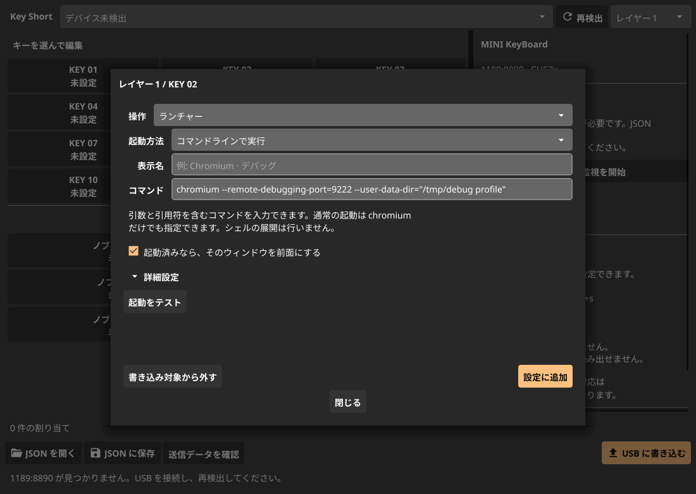

# アプリランチャーの使い方

ランチャーは、MINI KeyBoard のキーやノブの操作で PC 上のアプリを起動する機能です。Go で実装した常駐処理が、対象の USB デバイスからの入力だけを監視します。一般のキーボードは監視しません。



## アプリを選択する

キーの編集画面で「ランチャー」を選び、起動方法を「アプリを選択」にします。「アプリを選択…」からアプリ名で検索して選択できます。

アプリ一覧は XDG のアプリケーションディレクトリーと Flatpak / Snap のエクスポートから読み込みます。実際の起動は `gio launch` に委ねるため、デスクトップエントリーの引数、D-Bus 起動、端末アプリの扱いを引き継ぎます。`gio` は GLib のユーティリティーです。環境にない場合は Arch / Artix の `glib2`、Debian / Ubuntu の `libglib2.0-bin` を導入してください。

## コマンドと引数を指定する

起動方法を「コマンドラインで実行」にすると、コマンドと引数を入力できます。

通常の起動:

```text
chromium
```

デバッグ用の起動:

```text
chromium --remote-allow-origins=http://localhost:9222 --remote-debugging-port=9222 --user-data-dir=/tmp/key-short-chromium-debug
```

引数に空白が含まれる場合は引用符で囲みます。

```text
chromium --remote-debugging-port=9222 --user-data-dir="/tmp/debug profile"
```

通常のブラウザーとデバッグ用のブラウザーを分ける場合は、別の `--user-data-dir` を指定します。同じプロファイルでは、アプリ側の単一インスタンス機能によって既存プロセスへ起動要求が渡る場合があります。Key Short は入力した引数を変更しません。Chrome のデバッグ起動に関する条件は [Chrome の公式案内](https://developer.chrome.com/blog/remote-debugging-port) を参照してください。上記の `/tmp` はテスト用の一時プロファイルです。

コマンドは実行ファイルと引数に分解して直接実行します。`~`、環境変数、ワイルドカード、パイプは自動展開しません。環境変数を指定する場合は `env NAME=value program` を使用できます。シェルの機能が必要な場合は、次のように明示してください。

```text
sh -c 'your-command | another-command'
```

## 起動済みウィンドウを前面にする

「起動済みなら、そのウィンドウを前面にする」を有効にすると、次のように動作します。

1. 記録済みのウィンドウがあれば、最小化を解除して前面にします。必要に応じてウィンドウのある仮想デスクトップへ移動します。
2. ウィンドウがなく、起動中のプロセスもなければアプリを起動し、プロセスとウィンドウを記録します。
3. 起動処理中の連打はスキップします。プロセスが存在してもウィンドウを検出できない場合は、その状態を表示します。

無効にすると、押すたびに起動コマンドを実行します。実際に別のウィンドウを作るか、既存プロセスへ引き渡すかは起動先アプリの仕様に従います。

起動履歴には PID、プロセスの開始時刻、ウィンドウ ID、セッション情報を記録します。ラッパーや子プロセスも追跡できるよう、起動時に識別用の環境変数を付与します。履歴は `${XDG_STATE_HOME:-~/.local/state}/key-short/` に保存します。GUI や常駐処理を起動し直しても、同じデスクトップセッション内なら照合できます。OS やセッションが変わった履歴、別のプロセスに再利用された PID はそのまま使用しません。

コマンドと引数、起動方法、作業フォルダーなどが異なる設定は、それぞれ別の履歴として管理します。通常の Chromium とデバッグ用の Chromium を同じ設定として扱いません。

ウィンドウを特定できないアプリでは、「詳細設定」の「ウィンドウクラス」を指定できます。KDE では `resourceClass`、X11 では `WM_CLASS` のクラス名と照合します。この項目を指定すると同じクラスのウィンドウを再利用するため、別々の起動設定で同じクラスを指定した場合は共通のウィンドウに一致することがあります。

## 対応するデスクトップ環境

| 環境 | 前面化の方法 |
| --- | --- |
| KDE Plasma / Wayland | KWin の D-Bus と短時間のスクリプトでウィンドウを操作 |
| X11 | EWMH によるウィンドウの検出・アクティブ化 |
| その他の Wayland 環境 | 毎回起動は使用可能。ウィンドウの前面化には未対応 |

KDE のスクリプトは操作後にアンロードします。KWin の設定ファイルへの変更やプラグインの常設は行いません。画面ロック中の前面化や、ウィンドウ管理側の制約により操作できない場合は結果を表示します。前面化に失敗した場合に、代わりのプロセスを重複起動することはありません。

## USB ボタンで使用する

1. 更新版の `scripts/install-udev.sh` を sudo で実行し、USB デバイスを抜き差しします。
2. GUI で割り当てを追加し、JSON に保存します。
3. 「USB に書き込む」を実行します。
4. 「ランチャー監視を開始」を押します。

USB にはアプリのパスやコマンドを保存せず、ランチャー用の予約キーを設定します。予約キーを受け取った PC 側の常駐処理が、JSON にある起動設定を実行します。このため、ランチャーの使用中は GUI の監視機能または `-listen` の起動が必要です。

予約キーには F13〜F24 と修飾キーを使用します。レイヤー1は Ctrl+Alt+Super、レイヤー2は Ctrl+Shift+Super、レイヤー3は Alt+Shift+Super を組み合わせます。入力番号13〜18では右 Ctrl も追加します。予約キーと同じ操作を通常のキーボード割り当てに含めた JSON はエラーになります。

入力イベントは独占せずに読みます。予約キーもデスクトップへ届くため、同じショートカットをほかのアプリに登録した場合は両方が反応することがあります。

USB を抜いた後も監視を継続し、接続し直すと自動で検出します。GUI と CLI を含めて同時に監視できるのは1つだけです。「閉じてもトレイに常駐」を有効にすると、設定画面を閉じても監視を続けます。終了するときはトレイの「終了」を使用してください。起動済みのアプリは Key Short の終了後も動き続けます。

## CLI から使用する

設定ファイルからボタンの操作を監視します。終了は Ctrl+C です。

```sh
./bin/key-short -listen /absolute/path/to/key-short.json
```

指定スロットの動作を直接実行できます。デスクトップ環境のショートカットから呼び出す用途にも使用できます。

```sh
./bin/key-short -launch /absolute/path/to/key-short.json -layer 1 -slot 2
```

`-launch` は USB への書き込みやボタン監視を開始しません。同じコマンドを再実行した場合も、保存済みの起動履歴を照合します。

## 設定ファイルの例

```json
{
  "version": 1,
  "device": "1189:8890",
  "led": null,
  "bindings": [
    {
      "layer": 1,
      "slot": 1,
      "kind": "launcher",
      "value": "Chromium Debug",
      "launch": {
        "mode": "command",
        "command": "chromium --remote-debugging-port=9222 --user-data-dir=/tmp/key-short-debug",
        "reuse_window": true
      }
    }
  ]
}
```

アプリ選択の場合は `mode` を `application` にし、`command` の代わりに `desktop_file` へ `.desktop` ファイルの絶対パスを保存します。従来の `keyboard`、`media`、`mouse` の JSON も引き続き読み込めます。
