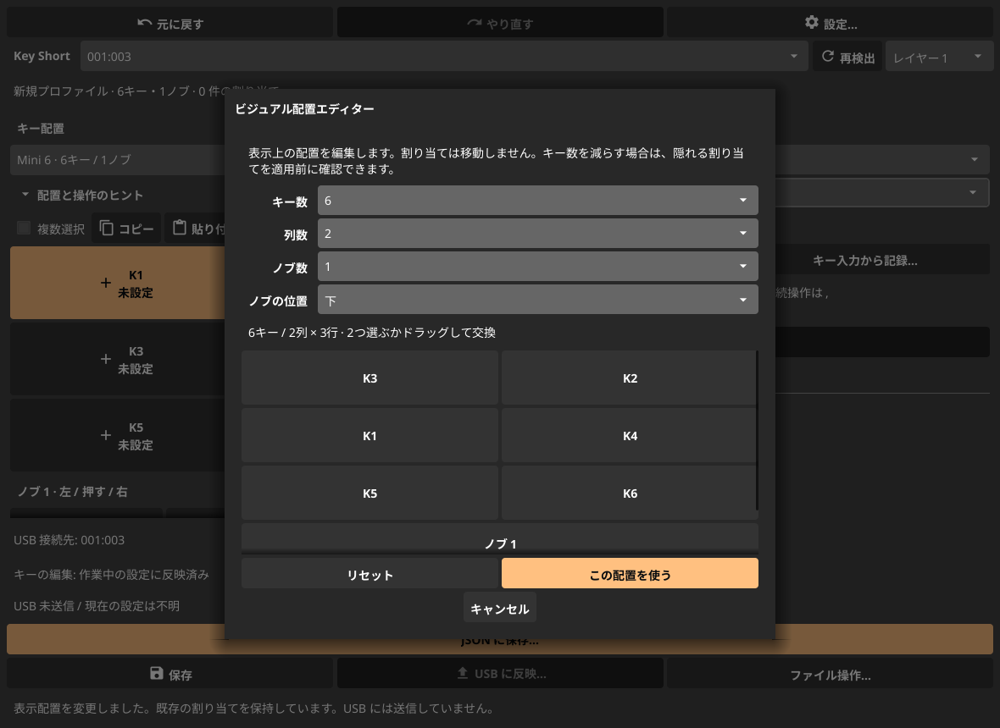

# キー配置の設定

「キー配置」から、接続したマクロパッドの形に合うプリセットを選択します。対象は USB ID `1189:8890` と、現在実装している Report ID 3 の通信方式です。プリセットの選択は表示と送信対象の検証に使います。選択しただけでは本体へ書き込みません。

## プリセット

| プリセット | 列 × 行 | キー | ノブ |
| --- | --- | --- | --- |
| Mini 3 | 3 × 1 | 3 | 1 |
| Mini 6 | 2 × 3 | 6 | 1 |
| Mini 9 | 3 × 3 | 9 | 2 |
| Mini 12 | 4 × 3 | 12 | 2 |
| Mini 12（縦配置） | 3 × 4 | 12 | 2 |

初期のスロット順序は左上から行ごとに K1、K2…です。これは表示の初期値であり、各機種の物理順序を実機で検証した結果ではありません。同じキー数でも順序が異なる場合は、次の手順で調整します。

1. プリセットを選び、「配置を変更…」を開きます。
2. キー数・列数・ノブ数・ノブの位置を選びます。
3. キーを2つ順番に選ぶかドラッグすると、表示上の位置を交換します。Tab と Enter でも選択できます。
4. ノブ同士も同じ操作で交換できます。「回転方向を反転」で左右の操作の対応を変更します。
5. 「この配置を使う」で反映し、JSON に保存します。「リセット」でダイアログを開いた時点の配置に戻します。

キーは1〜12、ノブの操作は13〜18から重複しないスロットを使用します。キー数が3の場合も、ノブのスロットを4〜6には変更しません。標準のノブ1は13・14・15、ノブ2は16・17・18です。ノブ数を0にすると、ノブのない配置を保存できます。



本体の現在の設定は読み出せません。通常のキー入力だけから、元の物理スロットを特定する機能はありません。この画面は手動の対応表編集です。識別用の一時的なキー割り当てを本体へ自動送信する機能は実装していません。

## 既存の割り当てを保持する

表示の並びを変えても、割り当ては元の物理スロット番号に残ります。例えば、K3 を左上に移しても、K3 の割り当てを K1 へコピーすることはありません。

小さい配置への変更で割り当てが隠れる場合は、全レイヤーの対象と割り当てを一覧表示します。「保持して配置を変更」は割り当てを残し、「送信対象から除外して変更（実機は保持）」は JSON の送信対象から除外します。キャンセルでは変更しません。除外は実機の設定を消去しません。どちらも Undo で元に戻せます。

配置外のスロットを含む設定は JSON に保存できます。USB 送信と監視開始は保留します。画面下部の「非表示の割り当てを確認…」から全キーの表示に戻すか、対象を一覧から除外してください。非表示の割り当てがあっても、表示中のキーの有効な編集は自動反映します。

## 検出と復元

USB ID だけではキー数や物理順序を確定しません。画面には「機種未確定」と表示し、プリセットを選べる状態にします。`1189:8890` に、別系統の機種向けのレイアウト照会コマンド `0xFB` を送ることはありません。`8840` / `8842` などの別プロトコルは未対応です。

選択した配置は JSON の `layout` に保存します。`layout` のない過去の JSON は、従来の12キー・2ノブ、3列 × 4行で開きます。開いている JSON の配置を、接続時の復元処理で上書きしません。

配置を選択すると、アプリの設定にも接続情報に対応付けて記憶します。Linux では sysfs の USB 接続位置とシリアル、Windows/macOS では HID パスとシリアルを使います。同じ工場出荷時シリアルを持つ個体の衝突を避けるため、シリアルだけでは照合しません。バス上の一時的なデバイス番号も照合キーには使いません。

次回の起動や「再検出」時に、開いている JSON、編集中の変更、既存の割り当てがなければ、保存済みの配置を自動復元します。接続位置による復元であり、機種を確定した結果ではありません。USB ポートの移動、HID パスの変更、OS の変更では再選択が必要になる場合があります。持ち運ぶ設定は JSON に保存してください。接続情報を取得できない場合も JSON から復元できます。

## JSON の例

以下は6キーの表示順を手動で並べ替える例です。この順序がすべての6キー機種に一致するとは限りません。

```json
{
  "version": 1,
  "device": "1189:8890",
  "layout": {
    "preset": "custom",
    "columns": 2,
    "slots": [3, 6, 2, 5, 1, 4],
    "knobs": [{"left": 13, "press": 14, "right": 15}]
  },
  "led": null,
  "bindings": []
}
```

`slots` は行順に並んだ表示位置とプロトコルのスロット番号の対応です。`knobs` は表示するノブの操作とスロット番号の対応です。省略可能な `knob_position` は `top`・`bottom`・`left`・`right` から選び、省略時は下に配置します。JSON と CLI も同じ検証処理を使い、配置に存在しないスロットへの送信を拒否します。

## 調査資料

- [3キー・1ノブの1189:8890向け実装](https://github.com/devkev/hid-minikb-libusb)
- [6キー・1ノブの1189:8890向け実装](https://github.com/nonatofabio/macrokey-driver)
- [CH57x の世代別通信と読み戻しの対応](https://github.com/wimpysworld/WonKey/wiki/hardware)

これらの資料でも機種やプロトコルが分かれています。本アプリのプリセット追加は、各個体の通信や物理スロット順序の実機検証を保証するものではありません。
