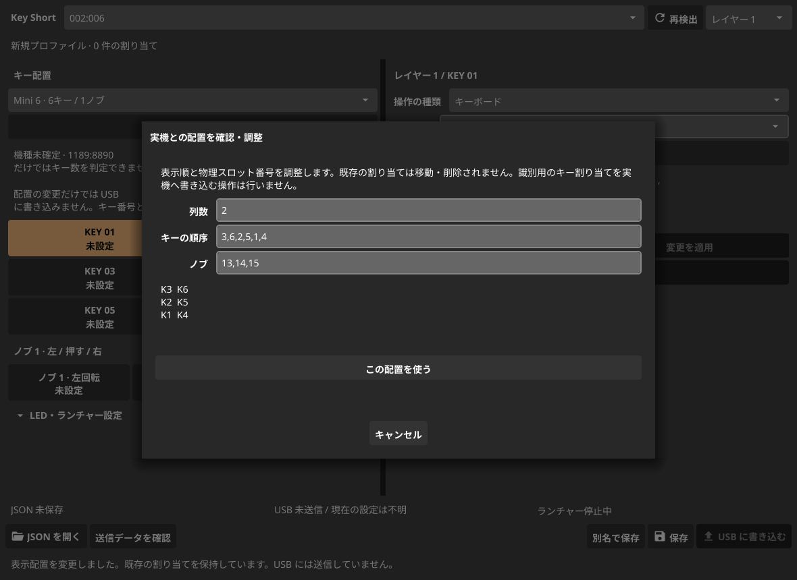

# キー配置の設定

「キー配置」から、接続したマクロパッドの形に合うプリセットを選択します。対象は USB ID `1189:8890` と、現在実装している Report ID 3 の通信方式です。プリセットの選択は表示と送信対象の検証に使います。選択しただけでは本体へ書き込みません。

## プリセット

| プリセット | 列 × 行 | キー | ノブ |
| --- | --- | --- | --- |
| Mini 3 | 3 × 1 | 3 | 1 |
| Mini 6 | 2 × 3 | 6 | 1 |
| Mini 9 | 3 × 3 | 9 | 2 |
| Mini 12 | 4 × 3 | 12 | 2 |
| Mini 12（縦配置） | 3 × 4 | 12 | 2 |

初期のスロット順序は左上から行ごとに K1、K2…です。これは表示の初期値であり、各機種の物理順序を実機で検証した結果ではありません。同じキー数でも順序が異なる場合は、次の手順で調整します。

1. プリセットを選び、「スロットの並びを調整…」を開きます。
2. 列数と、左上から行順に並べたキーの物理スロット番号を入力します。
3. ノブは左回転、押下、右回転の順に指定します。ノブ同士は `;` で区切ります。
4. プレビューを確認し、「この配置を使う」を押します。
5. 必要な割り当てを右側で編集して適用し、JSON に保存します。

キーは1〜12、ノブの操作は13〜18から、重複しないスロット番号を指定します。キー数が3の場合も、ノブのスロットを4〜6には変更しません。標準のノブ1は13・14・15、ノブ2は16・17・18です。ノブ欄を空にすると、ノブのない配置を保存できます。



本体の現在の設定は読み出せません。通常のキー入力だけから、元の物理スロットを特定する機能はありません。この画面は手動の対応表編集です。識別用の一時的なキー割り当てを本体へ自動送信する機能は実装していません。

## 既存の割り当てを保持する

表示の並びを変えても、割り当ては元の物理スロット番号に残ります。例えば、K3 を左上に移しても、K3 の割り当てを K1 へコピーすることはありません。

小さい配置へ切り替えたときに表示されなくなった割り当ても、JSON に保存できます。ただし、配置外のスロットを含むプロファイルは、全レイヤーについて USB 送信とランチャー監視の開始を拒否します。大きい配置へ戻して該当する割り当てを「書き込み対象から外す」か、割り当てを含む配置へ戻してから送信してください。「書き込み対象から外す」は、本体の設定の消去ではありません。

## 検出と復元

USB ID だけではキー数や物理順序を確定しません。画面には「機種未確定」と表示し、プリセットを選べる状態にします。`1189:8890` に、別系統の機種向けのレイアウト照会コマンド `0xFB` を送ることはありません。`8840` / `8842` などの別プロトコルは未対応です。

選択した配置は JSON の `layout` に保存します。`layout` のない過去の JSON は、従来の12キー・2ノブ、3列 × 4行で開きます。開いている JSON の配置を、接続時の復元処理で上書きしません。

配置を選択すると、アプリの設定にも接続情報に対応付けて記憶します。Linux では sysfs の USB 接続位置とシリアル、Windows/macOS では HID パスとシリアルを使います。同じ工場出荷時シリアルを持つ個体の衝突を避けるため、シリアルだけでは照合しません。バス上の一時的なデバイス番号も照合キーには使いません。

次回の起動や「再検出」時に、開いている JSON、編集中の変更、既存の割り当てがなければ、保存済みの配置を自動復元します。接続位置による復元であり、機種を確定した結果ではありません。USB ポートの移動、HID パスの変更、OS の変更では再選択が必要になる場合があります。持ち運ぶ設定は JSON に保存してください。接続情報を取得できない場合も JSON から復元できます。

## JSON の例

以下は6キーの表示順を手動で並べ替える例です。この順序がすべての6キー機種に一致するとは限りません。

```json
{
  "version": 1,
  "device": "1189:8890",
  "layout": {
    "preset": "custom",
    "columns": 2,
    "slots": [3, 6, 2, 5, 1, 4],
    "knobs": [{"left": 13, "press": 14, "right": 15}]
  },
  "led": null,
  "bindings": []
}
```

`slots` は行順に並んだ表示位置とプロトコルのスロット番号の対応です。`knobs` は上から順に表示するノブの操作とスロット番号の対応です。JSON と CLI も同じ検証処理を使い、配置に存在しないスロットへの送信を拒否します。

## 調査資料

- [3キー・1ノブの1189:8890向け実装](https://github.com/devkev/hid-minikb-libusb)
- [6キー・1ノブの1189:8890向け実装](https://github.com/nonatofabio/macrokey-driver)
- [CH57x の世代別通信と読み戻しの対応](https://github.com/wimpysworld/WonKey/wiki/hardware)

これらの資料でも機種やプロトコルが分かれています。本アプリのプリセット追加は、各個体の通信や物理スロット順序の実機検証を保証するものではありません。
