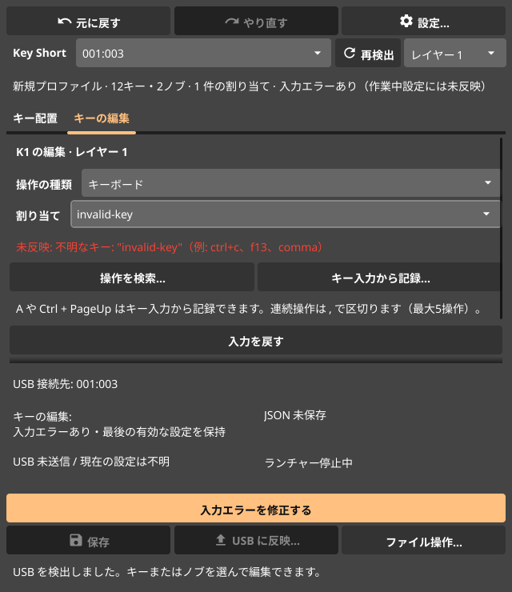

# 編集と反映の操作

キーやノブを選び、割り当てを編集します。有効な変更は作業中の設定に自動反映します。キーやレイヤーの切り替えで適用ボタンを押す必要はありません。USB 未接続でも編集・保存できます。ウィンドウを狭くすると「キー配置」と「キーの編集」のタブに切り替わります。入力途中の内容とスクロール位置を保持します。

## 保存と USB への反映

画面下部に、編集・JSON・USB・ランチャー監視の状態を表示します。強調したボタンは、入力エラーの修正、非表示の割り当ての確認、JSON 保存、USB の再検出・転送、監視の再開の順で次の操作を案内します。「保存」「USB に反映…」は個別にも使用できます。

| 操作 | 結果 |
| --- | --- |
| キーを編集 | 有効な設定だけを作業中の設定へ反映。JSON と USB は変更しない |
| JSON に保存 | 作業中の設定をファイルに保存。USB の転送状態は変更しない |
| USB に反映 | 確認画面で指定したデバイスへ設定を転送 |
| 監視を再開 | 作業中の設定を使ってランチャー監視を開始 |

無効な入力はエラーを表示し、最後の有効な設定を保持します。「入力を戻す」は無効な入力を最後の有効な設定へ戻します。設定全体を以前の状態へ戻す場合は Undo を使用します。

USB の転送完了後は「転送完了・実機動作未確認」と表示します。実機の設定を読み戻す機能はありません。キーとノブを操作して動作を確認してください。転送途中の失敗は一部だけ反映された可能性を表示します。

## Undo と Redo

キーの編集、割り当ての移動・交換・貼り付け・複製・除外・無効化、表示配置、LED の変更を同じ履歴に記録します。最大200操作を保持します。複数選択への貼り付けは1回の Undo で戻します。無効な入力がある場合は、最初の Undo で入力だけを戻します。

履歴はこのウィンドウ内の作業用です。JSON を開くと履歴を初期化します。Undo で JSON 保存時と同じ設定に戻ると未保存表示を解除します。USB 転送や JSON ファイル自体は Undo の対象にしません。

## コピーと複数選択

キーを選び「コピー」を押し、貼り付け先を選んで「貼り付け」を押します。「複製」は表示中のレイヤーの未設定キーへコピーします。

「複数選択」を有効にすると、クリックまたは Tab と Enter で対象を選べます。1件をコピーして複数のキーへ貼り付けるか、同じ数のキーをコピーして貼り付けます。複数の対応順序はスロット番号順です。レイヤーを切り替えると複数選択を解除します。入力エラーやランチャー予約キーの衝突がある貼り付けは、全体を反映しません。

コピーしたデータには起動コマンドや作業フォルダーも含まれます。ランチャーの貼り付けでは、貼り付け先のレイヤーとスロットから起動用キーを生成します。

| ショートカット | 操作 |
| --- | --- |
| Ctrl+S | JSON に保存 |
| Ctrl+Z | Undo |
| Ctrl+Shift+Z / Ctrl+Y | Redo |
| Ctrl+C / Ctrl+V | 割り当てをコピー・貼り付け |
| Ctrl+D | 未設定キーへ複製 |

macOS では Ctrl の代わりに Command を使います。文字入力欄のコピー・貼り付けは文字を対象にします。Undo/Redo は文字入力欄にフォーカスがあっても設定の履歴を操作します。ダイアログや入力記録中は設定用ショートカットを実行しません。

## 操作名と送信対象

メディア・マウスの操作名は日本語で表示します。「操作を検索…」で種類・日本語名・キー名を検索できます。内部の種類と値は「詳細（内部データ）」で確認できます。カードは設定済み・未設定・無効化・選択状態を文字、アイコン、色で表示します。

「送信対象から除外（実機は保持）」は設定から項目を取り除きます。実機の割り当てを消すデータは送りません。「無効化を設定（USB 反映が必要）」は無操作を表す `keyboard` の `none` を設定します。USB 転送後の結果は実機で確認してください。

## 監視とデバイス設定

「設定…」に LED、監視、トレイ常駐、監視の自動起動をまとめています。起動コマンドの作業フォルダーやウィンドウクラスは、ランチャー編集の「詳細設定」から変更できます。

有効な設定変更や JSON 読み込みで監視を停止した場合は、停止理由と再開操作を表示します。自動起動の定期的な状態確認でも停止理由を保持します。デーモンの開始・再起動は保存済み JSON を使うため、編集を保存してから実行してください。

配置は開いている JSON を優先し、それがなければ接続位置に記憶した配置を復元します。USB ID のみでプリセットを確定せず、未確認の識別コマンドや識別用設定を送信しません。詳しくは [キー配置の設定](layouts.md) を参照してください。
